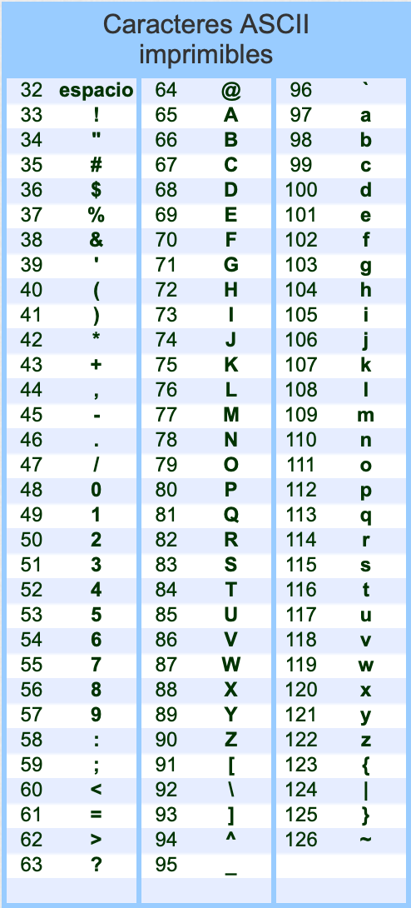
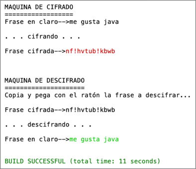

# Tema 2 - Ejercicios de cadenas

## Métodos de String en Java

Los 10 métodos de `String` más usados. En todos los ejemplos:

```java
String s = "Hola Mundo";
```

| # | Método | Qué hace | Ejemplo | Resultado |
|---|--------|----------|---------|-----------|
| 1 | `length()` | Devuelve el número de caracteres | `s.length()` | `10` |
| 2 | `charAt(i)` | Devuelve el carácter de la posición `i` (empieza en 0) | `s.charAt(0)` | `'H'` |
| 3 | `substring(ini, fin)` | Extrae desde `ini` hasta `fin` (sin incluir `fin`) | `s.substring(0, 4)` | `"Hola"` |
| 4 | `indexOf(texto)` | Posición de la primera aparición, o `-1` si no aparece | `s.indexOf("Mundo")` | `5` |
| 5 | `equals(otro)` | Compara el contenido de dos cadenas | `s.equals("Hola Mundo")` | `true` |
| 6 | `equalsIgnoreCase(otro)` | Compara sin distinguir mayúsculas y minúsculas | `s.equalsIgnoreCase("hola mundo")` | `true` |
| 7 | `toUpperCase()` / `toLowerCase()` | Pasa a mayúsculas o a minúsculas | `s.toUpperCase()` | `"HOLA MUNDO"` |
| 8 | `trim()` | Quita los espacios del principio y del final | `"  hola  ".trim()` | `"hola"` |
| 9 | `replace(viejo, nuevo)` | Sustituye todas las apariciones de un texto por otro | `s.replace("o", "0")` | `"H0la Mund0"` |
| 10 | `split(separador)` | Parte la cadena y devuelve un array | `s.split(" ")` | `{"Hola", "Mundo"}` |

> **Ojo:** para comparar cadenas usa siempre `equals`, nunca `==`.

**Otros útiles:** `contains`, `startsWith`, `compareTo`.

Consula el [API JAVADOC 21](https://docs.oracle.com/en/java/javase/21/docs/api/index.html) para más información (java.lang.String).

## Ejercicio01 - Contar apariciones de letras
Dada la frase `String frase = "Yo he visto cosas que vosotros no creeríais"`
- Hacer un programa que te pida una letra y te cuente las apariciones de dicha letra en la frase. Repetir en bucle. Salir al pulsar INTRO y no introducir ninguna letra.

## Ejercicio02 - contar vocales y consonantes
Dada la frase `"String frase= "El covid19 es lo peor"`, indicar el numero de vocales y de consonantes de la frase.

## Ejercicio03 - funciones indexof, replace, contains
Dada la frase (en mayúsculas y con espacios al principio y final) `String frase= "   HOMBRES Y MUJERES TENEMOS LOS MISMOS DERECHOS   "`:
- ¿Aparece la palabra "mujeres"?. Hazlo con `indexOf()` y con `contains()`.
- Indicar el numero de palabras que tiene (debe salir 7)
- Cambia los espacios en blanco de la frase original por el carcarter '_'
- Elimina los espacios en blanco de la frase. Debe salir `HOMBRESYMUJERESTENEMOSLOSMISMOSDERECHOS`

## Ejercicio04 - substring
Hacer un programa que te pida un email como "ana@gmail.com" y muestre por separado el usuario y el dominio, usando indexOf() junto con substring. Hacerlo en bucle y terminar con INTRO.
```java
ana@gmail.com
  usuario: ana
  dominio: gmail.com
```

## Ejercicio05 - eliminar blancos
Dada una cadena por teclado, eliminar espacios en blanco pero sin usar la función `replace()`. Para ello, recorre letra a letra la cadena y usa la concatenación de cadenas en java (el símbolo +) para acumular caracteres.
```
frase = frase + caracter
```

## Ejercicio06 - let's rock
Dada la cadena **"el rock mola siempre"**, convertir la frase a mayúsculas y cambiar las letras 'o' por un cero y las letras 'i' por el numero 1. La salida será: **"EL R0CK M0LA S1EMPRE"**.
El ejercicio hay que hacerlo concatenando carácter a carácter, y antes de concatenarlo, pasarlo a mayúsculas. Es decir, no puedo usar la función replace() dos veces y luego usar la función toUpperCase().

## Ejercicio07 - apariciones de palabras
Contar las apariciones de una palabra en una frase. Definir una frase en código (para agilizar).    

`String frase="No hay camino para la paz, la paz es el camino"` 

El programa pedirá al usuario una palabra y se indicará las veces que aparece en la frase. **IMPORTANTE: no puedes usar split**.
```text
Frase --> No hay camino para la paz, la paz es el camino

Dime palabra [INTRO para fin]: paz
   > La palabra "paz" aparece 2 veces.

Dime palabra [INTRO para fin]: casa
   > La palabra "casa" aparece 0 veces.

Dime palabra [INTRO para fin]: 

FIN       
```


## Ejercicio08 - conversor de frases
Escribe un programa en Java que pida al usuario una frase por teclado y, a continuación, muestre repetidamente el siguiente menú hasta que el usuario decida salir:
```text
--- MENÚ ---
Frase actual: hola mundo de java
1. Pasar a UpperCamelCase
2. Pasar a snake_case
3. Resetear frase
4. Salir
Elige una opción:
``` 
Cada opción debe hacer lo siguiente:

1. Pasar a UpperCamelCase: muestra la frase sin espacios, con la primera letra de cada palabra en mayúscula y el resto en minúscula.   

Ejemplo: hola mundo de java → HolaMundoDeJava

2. Pasar a snake_case: muestra la frase en minúsculas, con los espacios sustituidos por guiones bajos (_).   

Ejemplo: Hola Mundo de Java → hola_mundo_de_java

3. Resetear frase: vuelve a pedir una frase nueva por teclado, que sustituye a la anterior.

Si el usuario introduce una opción que no está entre 1 y 4, el programa mostrará el mensaje “Opción no válida” y **sin repetir el menú**, te pedirá otra vez la opción.

## Ejercicio09 - estraer palabras sin split
Extraer la primera y la tercera palabra de la frase "Alicia tiene 35 años". No se puede usar split. 


## Ejercicio10 - maquina de cifrado
### Base de conocimiento
¿Sabías que un carácter de tipo char se puede tratar como un número? Es su código ASCII.

El carácter 'a' equivale al 97  
El carácter 'C' equivale al 67  
El carácter '7' equivale al 55  



Además, se pueden hacer sumas con caracteres: 'd' + 5 da 105, que es el código de la 'i'. Para obtener el carácter hay que hacer un casting: (char) ('d' + 5) es 'i'.

### Enunciado
**PARTE 1: Cifrado (tipo César, con desplazamiento 1)**  
Haz un programa que pida una frase por teclado y la cifre, guardando el resultado en una variable llamada fraseCifrada. Para ello, cada carácter se sustituye por el carácter cuyo código ASCII es una unidad mayor (1 sería la clave del cifrado César). Los espacios también se cifran: el espacio (32) pasa a ser '!' (33).

Pista para concatenar: `fraseCifrada = fraseCifrada + Character.toString(caracter)`

**PARTE 2: Descifrado**  
A continuación, el programa pedirá una frase cifrada (el usuario la copiará y pegará con el ratón) y la descifrará, restando una unidad al código de cada carácter.



MEJORA OPCIONAL: el ejercicio se podría mejorar escogiendo la clave de cifrado, en lugar de 1, un número entre 1 y 10, por ejemplo. Se complica porque te sales fuera de rango. La z (122), podría convertirse en el 132. Habría que hacer que del 126 pasase al 32. De esta manera, la z+10 sería 37.  