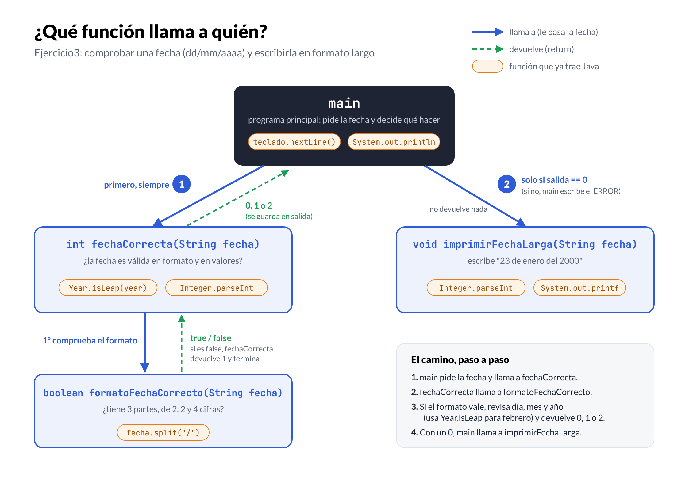
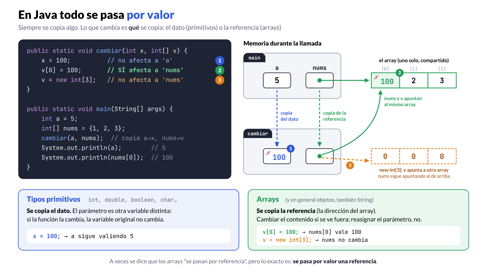

# Tema 2 - Ejercicios de funciones

## Ejercicio01 - función esPar()
Crea una función llamada esPar() que te diga si dicho número es par o no.
- Parámetros de entrada: el número a verificar
- Parámetros de salida: verdadero o falso según sea el número par o impar

Haz luego un programa que te pida números en bucle (hasta meter el cero) y te diga si cada número es par o no, haciendo uso de la función anterior.


## Ejercicio02 - función fechaCorrecta()
Crea una función que te diga si una fecha es correcta o no. Puedes usar el algoritmo de los ejercicios anteriores (Condicional - Ejercicio11).
- Parámetros de entrada: día, mes y año
- Parámetros de salida: verdadero o falso según sea el número par o impar

Haz luego un programa que te pida una fecha en formato dd/mm/aaaa y te diga si es correcta o no.   


## Ejercicio03 - funciónes gestionar fechas
Haz un programa que te pida una fecha en formato dd/mm/aaaa y si tiene bien el formato y es correcta, la imprima en formato "largo".

Para hacer las siguientes funciones, puedes usar el algoritmo de los ejercicios anteriores (Arrays - Ejercicio10)   

Crea tres funciones:
- Función formatoFechaCorrecto(): comprueba el formato dd/mm/aaaa
  - Parámetros de entrada: la fecha en formato dd/mm/aaaa
  - Parámetros de salida: verdadero o falso   
  

- Función fechaCorrecta(): comprueba si es correcta, tanto en formato como en valores. 
  - Parámetros de entrada: la fecha en formato dd/mm/aaaa
  - Parámetros de salida: 0 correcta, 1 error de formato, 2 error de valores

- Función imprimirFechaLarga(): imprime la fecha en formato "largo"
  - Parámetros de entrada:  la fecha en formato dd/mm/aaaa
  - Parámetros de salida: ninguno

```text
>Fecha (dd/mm/aaaa): 21/01/2020
  Fecha introducida: 21 de enero del 2020
  
>Fecha (dd/mm/aaaa): 21/13/2020
  ERROR: esa fecha no es posible
  
>Fecha (dd/mm/aaaa): 1/1/2020
  Formato de fecha incorrecto
```




## Ejercicio04 - función imprimirArray()
Hacer una función que te imprima un array de la forma lo más bonita posible. 

```text
+----+----+----+----+
|   3|   7|   1|   9|
+----+----+----+----+

o con indices

    0    1    2    3
+----+----+----+----+
|   3|   7|   1|   9|
+----+----+----+----+


o como tu quieras.
```

SUPER MEJORA: crea el paquete **utilidades** y dentro del mismo, la clase **Util**. Dentro de esta clase, no creas ningún método _main_. Pega la función creada de **imprimirArray**. Con esto, ya podrás usar la función en otros ejercicios con la llamada
```java
import utilidades.Util;
Util.imprimirArray(UN_ARRAY);
```


## Ejercicio05 - función arrayAleatorio()
Crear una función para generar un array de números enteros aleatorios.
- Parámetros de entrada:  tamaño del array, rango inferior y superior, ambos incluidos.
- Parámetros de salida: el array generado.

Hacer un programa pida por teclado tamaño y rango, y te imprima el array generado, usando las funciones anteriores


## Ejercicio06 - comparar y fusionar arrays  

### Primera función: compararArrays()
Hacer una función que reciba dos arrays como parámetros y diga si son iguales, número a número
El prototipo de la función será:  

`boolean compararArrays(int [] lista1, int [] lista2)`

### Segunda función: fusionarArrays()
Hacer una función que reciba dos arrays como parámetros y devuelva otro con la lista de ambos arrays.  
El prototipo de la función será:  

`int[] fusionarArrays(int [] lista1, int [] lista2)`

### Programa principal
Define dos arrays en código y comprueba si son iguales y fusiónalos en uno solo.


## Ejercicio07 - palindromo
¿Es palíndromo una palabra?

Crea dos funciones:

- `invertir(String texto)`: devuelve la cadena al revés.
- `esPalindromo(String texto)`: llama a invertir y compara el resultado con el texto original (sin distinguir mayúsculas y minúsculas).

En main, pide una palabra por teclado y di si es palíndromo o no.

## Ejercicio08 - conversor de frases con funciones
Este ejercicio **es una mejora** del Ejercicio08 de cadenas.

Escribe un programa en Java que pida al usuario una frase por teclado y, a continuación, muestre repetidamente el siguiente menú hasta que el usuario decida salir:
```text
================================================
Frase original: Hola mundo de Java
Snake_case: hola_mundo_de_java
================================================
1. Pasar a UpperCamelCase
2. Pasar a snake_case
3. Resetear frase
4. Salir
Elige una opción:
``` 
- Implementa funciones para las diferentes opciones.
- La frase original no se pierde
- Fíjate que en la segunda frase, debe aparecer el nombre del cambio aplicado.


## Ejemplo - Paso por referencia
Ejecuta el siguiente código y observa como los arrays se pasan por referencia y las variables primitivas por valor.



```java
import utilidades.Util;
public class PasoPorReferencia {
    public static void duplicar(int[] v) {
        for (int i = 0; i < v.length; i++) {
            v[i] = v[i] * 2;   // cambia el array original
        }
    }
    public static void duplicar(int n) {
        n = n * 2;   // solo cambia la copia
    }
    public static void mostrar(int[] v) {
        for (int i = 0; i < v.length; i++) {
            System.out.print(v[i] + " ");
        }
        System.out.println();
    }
    public static void main(String[] args) {
        int[] nums = {1, 2, 3, 4};
        Util.imprimirArray(nums);  //opcional mostrar(nums)
        duplicar(nums);   // no devuelve nada...
        Util.imprimirArray(nums);    // 2 4 6 8  ¡ha cambiado!

        System.out.println();
        int valor = 10;
        System.out.println("valor: "+valor);
        duplicar(valor);
        System.out.println("valor: "+valor);
    }
}
```

## Ejercicio 09 - incrementar valores array
Hacer una función llamada _incrementar()_ que le pasarás un array de enteros y un valor y incrementará todos los valores del array sumando dicho valor.


¿Devolvemos el array incrementado o no devolvemos nada? Piensa en como quedaría el main con ambos casos.


## Ejercicio 10 - hacer copia array
Hacer una función que me devuelva una copia de un array dado.